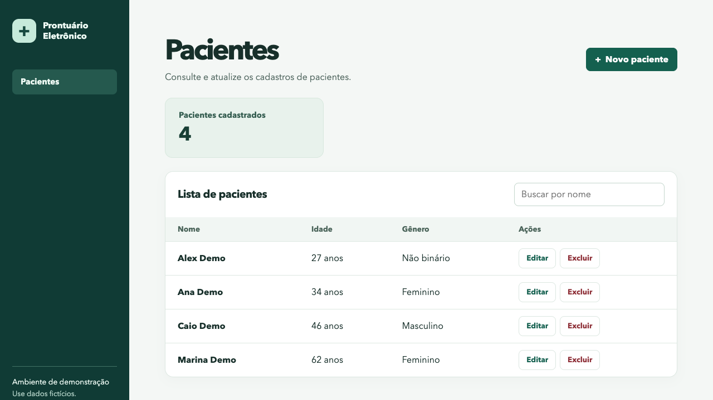

# Prontuário Eletrônico

Uma demo local de cadastro de pacientes com Node.js, TypeScript, Express e MongoDB. Pelo painel, você pode buscar pacientes por nome ou número do prontuário e consultar, cadastrar, editar e excluir fichas com dados hospitalares.

[](https://render.com/deploy?repo=https://github.com/DandaraEmiliano/prontuario_eletronico)



## Experimente

Na raiz do projeto, com Docker Compose disponível, rode:

```bash
docker compose up --build
```

Abra [http://localhost:3000](http://localhost:3000). O Compose inicia o painel com quatro pacientes fictícios e guarda os cadastros em um volume do MongoDB.

1. Clique em **Novo paciente** e cadastre um nome fictício.
2. Preencha o número do prontuário, a unidade, o leito e a situação do atendimento.
3. Localize o cadastro pelo número do prontuário e clique em **Ver ficha**.
4. Clique em **Editar**, mude a situação para **Alta hospitalar** e limpe o leito.
5. Clique em **Excluir** e confirme a remoção.

O painel é uma demonstração local sem autenticação. Use apenas dados fictícios.

## Demo no Render

O Blueprint cria um serviço web gratuito com Docker. O MongoDB da demo roda no mesmo contêiner, em armazenamento temporário. A cada reinício o painel volta aos quatro cadastros de exemplo. Os registros da demo pública ficam visíveis a todos os visitantes. Use apenas dados fictícios.

## Rode com Node.js

Com **Node.js 22 ou superior** e **MongoDB** em execução, rode:

```bash
npm ci
npm run build
MONGODB_URI=mongodb://127.0.0.1:27017/prontuario_demo PRONTUARIO_SEED=true npm start
```

| Variável | Padrão | Uso |
| --- | --- | --- |
| `MONGODB_URI` | `mongodb://127.0.0.1:27017/prontuario` | Conexão com o MongoDB |
| `PRONTUARIO_SEED` | Desativada | Com `true`, insere os exemplos ausentes na inicialização e preserva edições existentes |
| `HOST` | `127.0.0.1` | Endereço em que o servidor escuta |
| `PORT` | `3000` | Porta HTTP |

## Como funciona

O Express serve o painel estático e a API no mesmo endereço. O painel usa a API para consultar e gravar cadastros, e o Mongoose valida e persiste os dados no MongoDB.

| Método | Rota | Resultado |
| --- | --- | --- |
| `GET` | `/api/health` | Estado da conexão com o MongoDB |
| `GET` | `/api/patients` | Lista de pacientes |
| `POST` | `/api/patients` | Cria um cadastro e responde com HTTP 201 |
| `GET` | `/api/patients/:id` | Consulta um cadastro |
| `PUT` | `/api/patients/:id` | Atualiza os campos enviados |
| `DELETE` | `/api/patients/:id` | Exclui um cadastro e responde com HTTP 204 |

Envie JSON com `name` (texto), `age` (inteiro de 0 a 130) e `gender` (texto). A ficha também aceita campos opcionais.

| Informação | Campos |
| --- | --- |
| Identificação | `recordNumber` e `birthDate` |
| Localização e admissão | `unit`, `bed` e `admittedOn` |
| Atendimento | `careStatus` e `careTeam` |
| Informações clínicas | `bloodType` e `allergies` |

Envie as datas no formato `AAAA-MM-DD`. A situação usa `admitted`, `observation` ou `discharged`. O tipo sanguíneo usa os grupos A, B, AB ou O seguidos de `+` ou `-`. Use uma string vazia para limpar um campo opcional.

A API retorna HTTP 400 para dados inválidos e HTTP 404 para um identificador válido sem cadastro correspondente.

```bash
curl -i http://localhost:3000/api/patients \
  -H 'Content-Type: application/json' \
  -d '{"name":"Rafa Demo","age":29,"gender":"non-binary","recordNumber":"PR-1020","unit":"Clínica Médica","bed":"14-A","careStatus":"admitted"}'
```

## Testes

```bash
npm test
```

A suíte usa uma instância MongoDB acessível em `127.0.0.1:27017`. Para usar outra instância, defina `MONGODB_TEST_URI`. Os testes criam e removem um banco temporário com nome único. A suíte cobre o cadastro completo, a edição de dados hospitalares, validações, a carga de exemplos e as rotas do painel e de saúde.
